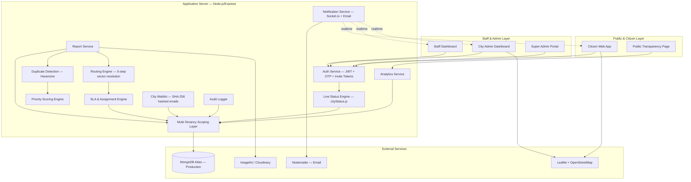
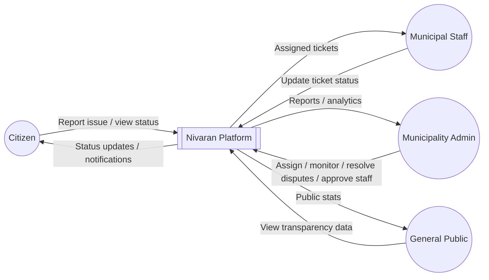
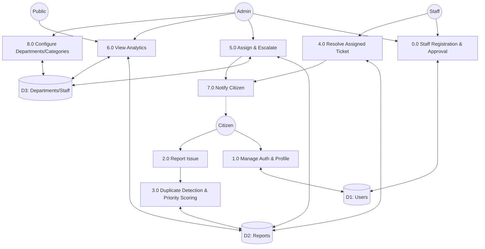
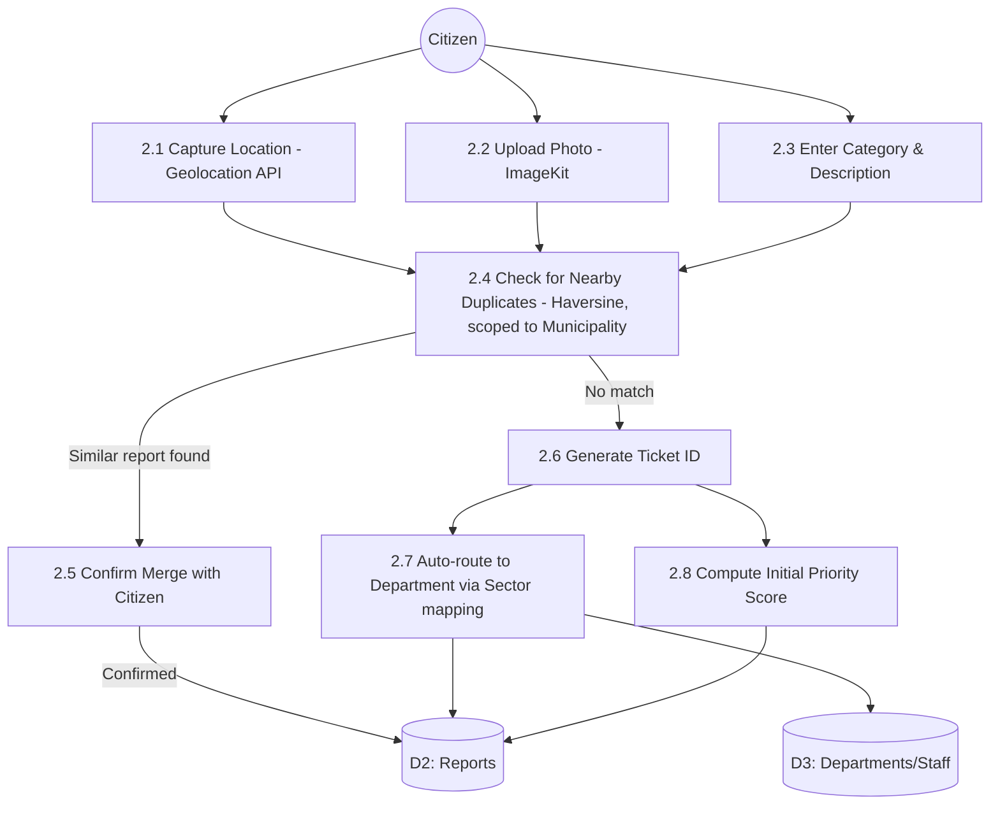

# Nivaran — National Civic Issue Reporting & Resolution Platform

> "निवारण" (Nivaran) means **resolution/remedy** — because every complaint deserves to be resolved, not just recorded.

> A MERN stack, **multi-tenant** platform that lets citizens report local civic issues (potholes, garbage, streetlights, water leaks, etc.) with photo + location, automatically detects duplicate reports, prioritizes them intelligently, and gives municipal staff and administrators the tools to track, assign, and resolve them transparently — architected so any Urban Local Body (ULB) in India can onboard independently, rather than being built for a single city.

**Tagline:** _Report it. Track it. Nivaran — Resolved._

Based on **SIH25031** — _Crowdsourced Civic Issue Reporting and Resolution System_ (Government of Jharkhand, Clean & Green Technology theme), since generalized beyond a single-municipality scope. Modeled on real-world deployed systems like **SeeClickFix**, **FixMyStreet**, and India's own **CPGRAMS** (Centralized Public Grievance Redress and Monitoring System).

---

## 🎯 Problem Statement

Citizens face broken infrastructure daily — potholes, overflowing garbage, faulty streetlights, water leaks — but reporting is scattered, duplicate complaints flood municipal systems, and there's no transparent tracking of resolution. This problem isn't specific to one city — every Urban Local Body in India faces it independently, with no shared platform. Nivaran centralizes reporting per municipality, eliminates duplicate noise through geolocation-based clustering, prioritizes issues by real urgency signals, and gives full transparency back to citizens and the public — while being architected so any municipality can onboard onto the same platform without being hardcoded to one.

---

## 🏛️ Administrative Model

Nivaran's data model follows India's real municipal governance structure, from the **74th Constitutional Amendment**:

```
State
 └── Urban Local Body (Municipal Corporation / Municipal Council / Nagar Panchayat)
       └── Ward
             └── Citizens, Departments, Staff, Reports (all scoped here)
```

Each Urban Local Body (referred to as a **Municipality** in the platform) operates as an independent tenant — its own citizens, staff, departments, and reports are isolated from every other municipality on the platform, while all municipalities share the same core application and national issue taxonomy.

### National taxonomy vs. local implementation

A key design decision: the same civic function (e.g., water supply) is handled by a **different real agency in every city** — BWSSB in Bengaluru, Delhi Jal Board in Delhi, BMC's Water Dept in Mumbai. Hardcoding department names nationally would be inaccurate. So the model separates two layers:

- **Sector** — a fixed, _national_ taxonomy of **11 sectors**: Roads & Bridges, Water Supply, Sewerage & Drainage, Solid Waste, Electricity & Lighting, Traffic & Transport, Health & Sanitation, Parks & Gardens, Building & Town Planning, Municipal Enforcement, Other — never changes city to city
- **Department** — the real local implementing agency (e.g., "BWSSB", "Delhi Jal Board"), created and managed **by that municipality's own admin**, mapped to one Sector, tagged with an `agencyType` (`municipal_corp` vs. `parastatal_board`, since agencies like BWSSB/BESCOM are separate state boards, not part of the municipal corporation itself)
- **Category** (Pothole, Streetlight, etc.) stays fixed and national for consistent cross-municipality analytics, mapped to a Sector — individual municipalities can enable/disable categories and override severity weight / SLA hours to fit their local context, but can't fragment the taxonomy itself

This mirrors the "standardize the service, localize the provider" pattern used by real platforms like India's Sakala and CPGRAMS systems.

---

## 👥 Roles & Hierarchy

```
Super Admin (Platform Level) — provisions & monitors cities, invites city admins, manages national taxonomy & waitlist
 └── Municipality Admin (City Level) — manages local wings & external agencies, sets primary depts, approves staff
       └── Municipal Staff (Department Level) — approval-gated, handles assigned tickets, uploads resolution proof
 └── Citizen (Public) — self-registers, files reports, tracks progress, confirms merges, disputes resolutions
```

| Role | Responsibilities | Access Scope |
| :--- | :--- | :--- |
| **Super Admin** | Platform-wide oversight, provisions municipalities, invites initial city administrators, monitors computed city live readiness, manages national category taxonomy, views citizen city waitlist demands, audits all sensitive actions across ULBs | Global (Cross-Tenant Platform Administration) |
| **Municipality Admin** | Manages municipal departments and state external agencies, configures sector primary departments, configures category overrides (severity/SLA/routing), reviews and approves/rejects/revokes staff, assigns/reassigns/forwards tickets, reviews "Set up your city" checklist, resolves disputes | Tenant-Scoped (Restricted to their Municipality) |
| **Municipal Staff** | Self-registers (pending admin approval), views department ticket queue, updates status with mandatory before/after resolution proof, records field notes | Tenant & Department-Scoped (Municipal Wings only) |
| **Citizen** | Self-registers in live cities, reports geo-tagged issues, tracks ticket lifecycle, confirms duplicate merges, joins existing issues, rates resolutions, disputes unsatisfactory closures | Tenant-Scoped (Their Registered Municipality) |

---

## ✨ Key Features

- 📍 **Geo-tagged issue reporting** with photo upload, GPS auto-detect, and map coordinate picking (Leaflet + OpenStreetMap)
- 🔁 **Smart duplicate detection** — Haversine-based clustering (~50m radius) scoped within municipality; citizens confirm duplicate merges
- ⚖️ **Explainable priority scoring engine** — weighted ranking by report volume, category severity, days open, and upvotes
- 🎫 **Public ticket tracking** — human-readable ticket IDs with lifecycle timelines (submitted → assigned → in_progress → resolved / disputed)
- 🏙️ **Multi-tenant isolation & catalog** — state-level catalogs (e.g. 9 Punjab municipal corporations) with strict tenant data and WebSocket room isolation
- 🟢 **Computed Live status** — cities are live only when active, assigned an active admin, and initial password setup is completed; public registration and report filing are gated by live status (403 for catalog/non-live cities)
- 📋 **Privacy-first city waitlist** — citizens in unserved cities request onboarding via SHA-256 hashed emails; Super Admin views demand counts and sets rollout stages (`pending` → `reviewing` → `planned` → `launched`)
- 🏛️ **11 Standardized sectors & 5-step routing engine** — automated ticket resolution prioritizing local category force overrides, sector primary departments, sector fallbacks, general municipal fallback, or triage queue
- 🏢 **Municipal wings vs. External state agencies** — support for corporations' internal wings (Roads, Water, Sanitation) and external state agencies (PSPCL, PWD, Traffic Police, PPCB); external agencies receive forwarded tickets but cannot receive staff accounts
- 🔄 **Ticket operations** — internal department reassignment, external agency forwarding with agency reference IDs, and external status update logging with citizen-friendly timeline masking
- 🛡️ **Approval-gated staff onboarding** — municipal staff register with employee ID and designation, require admin approval, and support instant session invalidation via `tokenVersion` revocation
- ✅ **"Set up your city" readiness checklist** — dynamic admin view assessing sector coverage, primary department mapping, agency verification, and triage queues
- 🔒 **Immutable audit logging** — tamper-evident audit trail for admin actions (invitations, approvals, deactivations, primary swaps, forwardings, settings) with zero secret exposure
- 🌐 **Public transparency dashboard** — anonymous, live department-level resolution metrics, SLAs, and public issue maps

---

## 🛠️ Tech Stack

| Layer | Technology | Description |
| :--- | :--- | :--- |
| **Frontend** | React 18, Vite 5, React Router 6 | Modular component architecture |
| **Styling** | Vanilla CSS Design System | Curated HSL color palette, dark/light theme tokens, glassmorphism, responsive CSS grid/flexbox (no ad-hoc CSS frameworks) |
| **Backend** | Node.js (ESM), Express 4.19 | RESTful API with tenant scoping & validation middleware |
| **Database** | MongoDB (Atlas) + Mongoose 8.5 | Compound partial unique indexes for multi-tenant constraints |
| **Real-time** | Socket.io 4.8 | Tenant-scoped rooms (`muni:<id>:admins`, `muni:<id>:staff`, `user:<id>`) |
| **Authentication** | JWT + Bcryptjs + OTP | Role-based authorization, one-time invite tokens, token versioning |
| **Maps & GIS** | Leaflet.js, OpenStreetMap, Nominatim | GeoJSON coordinates, interactive pin placement, reverse geocoding |
| **Media Storage** | ImageKit / Cloudinary / Local Multer | Before & after visual evidence storage |
| **Testing** | Node Test Runner / Custom Suites | 8 dedicated suites with 138+ automated tests against isolated test database |

---

## 🧠 Core Algorithms

### 1. Duplicate Detection (Haversine Distance)

Detects if a newly reported issue is likely the same as an existing open report within a defined radius (~50m), the same category, and a recent time window — scoped to comparisons **within a single municipality only**. Citizens are shown the possible match and asked to confirm ("is this the same issue?") rather than being silently auto-merged, mirroring how real systems like FixMyStreet handle this.

### 2. Priority Scoring

```
priorityScore = (reportCount × W1) + (categorySeverityWeight × W2) + (daysOpen × W3) + (upvotes × W4)
```

A fully explainable, self-designed weighted formula — no black-box AI involved in core prioritization logic. Escalated tickets (past SLA deadline) receive an additional priority boost.

---

## 🏗️ System Architecture



Every request that touches Reports, Staff, or Departments passes through the **Multi-Tenancy Scoping Layer**, which filters by the requesting user's `municipality` — enforced server-side, not just hidden in the UI. Registration and report submission are additionally gated by the **Live Status Engine** — a city must be active, have an active admin, and have completed password setup before citizens can interact with it.


---

## 📊 Data Flow Diagrams (DFD)

### DFD Level 0 — Context Diagram



### DFD Level 1 — Major Processes



### DFD Level 2 — Expansion of "2.0 Report Issue"



---

## 🚀 Getting Started

### Prerequisites

- Node.js (v18+)
- MongoDB Atlas account
- ImageKit account
- Docker Desktop _(optional — for one-command local dev setup)_

### Setup

```bash
# Clone the repo
git clone https://github.com/<your-org>/nivaran.git
cd nivaran

# Install server dependencies
cd server
npm install

# Install client dependencies
cd ../client
npm install
```


### Seed the Database

The platform ships with a seeder that provisions the full Punjab city catalog, national categories, per-city departments and state agencies, and realistic demo data.

```bash
cd server

# Seed production / development database
npm run db:fresh          # resets and re-seeds MONGO_URI

# Seed the isolated test database (used by all test suites)
npm run db:fresh:test     # resets and re-seeds TEST_MONGODB_URI (Nivaran_test)
```

**Demo accounts seeded** (password: `Demo@123`):

| City | Admin | Citizens |
| :--- | :--- | :--- |
| Jalandhar | `admin.jalandhar@nivaran.gov` | `citizen1.jalandhar@example.com` |
| Phagwara | `admin.phagwara@nivaran.gov` | `citizen1.phagwara@example.com` |
| Ludhiana | `admin.ludhiana@nivaran.gov` | `citizen1.ludhiana@example.com` |

Each city also has 3 staff accounts (`staff.roads.*`, `staff.water.*`, `staff.sanitation.*`) and 20+ realistic reports spread across all 19 national categories.

### Run Locally

```bash
# Terminal 1 — backend (runs on http://localhost:5000)
cd server && npm run dev

# Terminal 2 — frontend (runs on http://localhost:5173)
cd client && npm run dev
```

Or, with Docker Desktop installed, run the whole stack via `docker compose up` — see `docker-compose.yml`. This is for local development convenience only; production deployment uses Vercel + Render + MongoDB Atlas directly.


## 🌍 Real-World Design References

- **SeeClickFix, FixMyStreet, 311 systems** — general civic-issue-reporting UX and workflow patterns
- **CPGRAMS** (India's Centralized Public Grievance Redress and Monitoring System) — the routing/multi-jurisdiction model Nivaran's multi-tenancy architecture mirrors
- **74th Constitutional Amendment** — the State → Urban Local Body → Ward administrative hierarchy this data model follows
- Real Indian municipal agency structures (e.g., BWSSB, BESCOM, Delhi Jal Board) — informing the Sector/Department separation, since the same civic function is handled by differently-named agencies across cities

---

## 📄 License

This project is developed as an academic capstone project.
